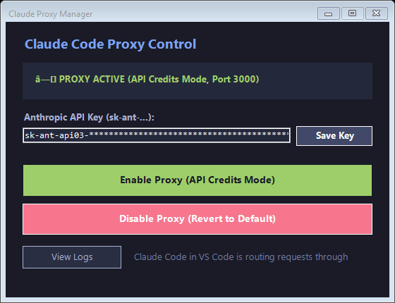

<p align="center">
  
</p>

# Claude Code Proxy

> **Transparent reverse proxy enabling standard Anthropic API keys & promotional developer credits with Claude Code.**

[](LICENSE)
[](https://nodejs.org)
[](#)

---

## The Problem

Anthropic provides monthly promotional API credits to developers (e.g. $100/month for Max/Team subscribers). However, by official policy, Anthropic **restricts Claude Code** from utilizing promotional credits, throwing:

```
API Error: 400 Your credit balance is too low to access the Anthropic API. Please go to Plans & Billing to upgrade or purchase credits.
```

Even if you set `ANTHROPIC_API_KEY`, Claude Code secretly injects hidden telemetry, billing headers, and prompt watermarks that signal Anthropic's edge gateway to reject the call unless you maintain a paid prepaid credit card balance.

---

## How It Works

This lightweight proxy acts as an intermediary between Claude Code (CLI or VS Code Extension) and `api.anthropic.com`. It transparently sanitizes outgoing requests so Anthropic perceives standard API SDK calls:

1. **Strips Billing Watermarks**: Automatically removes `x-anthropic-billing-header`, `cc_version`, and `You are Claude Code` injected into system prompts.
2. **Removes Client Telemetry**: Strips `anthropic-client`, `anthropic-cli-version`, `x-stainless-*`, and Claude Code beta gates.
3. **Cleans OAuth Interception**: Removes stale OAuth tokens that hijack requests to exhausted Claude web subscriptions.
4. **Fixes Schema Discrepancies**: Translates `role: 'system'` inside message history into `role: 'user'` and removes non-standard `tool_addition`/`tool_removal` blocks that trigger 400 errors.
5. **Prevents Brotli Compression Crashes**: Strips `accept-encoding: br` to ensure pristine, uncorrupted error messages.
6. **Preserves Model Selection**: Keeps your chosen model (e.g., `claude-opus-5-5`, `claude-sonnet-5-5`, etc.) intact with zero downgrades.

---

## Desktop GUI Control Panel (Windows)

The repository includes a modern graphical control panel for Windows with zero dependencies (runs on native Windows Forms):

<p align="center">
  
</p>

### Features:
- **1-Click Mode Toggle**:
  - 🟢 **Enable Proxy (API Credits)**: Automatically configures VS Code & CLI settings to use the local proxy and launches the background service.
  - ⚪ **Disable Proxy (Revert to Default)**: Completely reverts VS Code & CLI settings back to official Anthropic direct connection and restores subscription credentials.
- **In-App API Key Manager**: Edit and save your Anthropic API key directly in the UI.
- **Real-Time Status**: Visual indicator of whether the proxy is active on port 3000.
- **Live Logs**: Open `run.log` in Notepad to inspect model requests and status codes.

### Launch GUI or Create Desktop Shortcut:
```powershell
# Create Desktop Shortcut:
npm run create-shortcut
# or: powershell -ExecutionPolicy Bypass -File .\create_shortcut.ps1

# Launch GUI directly:
npm run gui
# or: powershell -ExecutionPolicy Bypass -File .\gui.ps1
```

---

## Quick Start (Manual / Headless)

### 1. Requirements
- Node.js 18 or newer (no `npm install` needed — pure native Node.js).

### 2. Run the Proxy Directly
```bash
# Clone the repository
git clone https://github.com/MOZARTINOS/claude-code-proxy.git
cd claude-code-proxy

# (Optional) Set your API key in environment or .env
cp .env.example .env

# Start the proxy
node server.js
```

The proxy starts listening on `http://127.0.0.1:3000`.

---

## Configuration

### Option A: VS Code Claude Code Extension

Open your VS Code `settings.json` (`Ctrl+Shift+P` -> `Preferences: Open User Settings (JSON)`) and add:

```json
{
  "claudeCode.disableLoginPrompt": true,
  "claudeCode.environmentVariables": [
    {
      "name": "ANTHROPIC_BASE_URL",
      "value": "http://127.0.0.1:3000"
    },
    {
      "name": "ANTHROPIC_API_KEY",
      "value": "sk-ant-api03-YOUR_KEY_HERE"
    },
    {
      "name": "CLAUDE_CODE_SKIP_AUTH_LOGIN",
      "value": "1"
    }
  ]
}
```

### Option B: Claude Code CLI

In your global settings file (`~/.claude/settings.json`):

```json
{
  "env": {
    "ANTHROPIC_BASE_URL": "http://127.0.0.1:3000",
    "ANTHROPIC_API_KEY": "sk-ant-api03-YOUR_KEY_HERE",
    "CLAUDE_CODE_SKIP_AUTH_LOGIN": "1"
  }
}
```

Or set environment variables in your terminal session:
```bash
export ANTHROPIC_BASE_URL=http://127.0.0.1:3000
export ANTHROPIC_API_KEY=sk-ant-api03-YOUR_KEY_HERE
export CLAUDE_CODE_SKIP_AUTH_LOGIN=1
claude
```

---

## Persistent Background Service (Windows Task Scheduler)

When running the proxy in a regular terminal or inside an IDE subprocess, closing the window or reloading the IDE terminates the proxy process, leading to `ECONNREFUSED`.

To ensure 100% uptime, you can register the proxy as an independent persistent background task in **Windows Task Scheduler**:

### Install as Windows Task Scheduler Service
```powershell
.\install_task.ps1
# or using npm:
npm run install-service
```
This registers a task `ClaudeCodeProxy` that runs detached in your user session and starts automatically upon Windows logon.

### Uninstall Service
```powershell
.\uninstall_task.ps1
# or using npm:
npm run uninstall-service
```

---

## License

[MIT](LICENSE)
